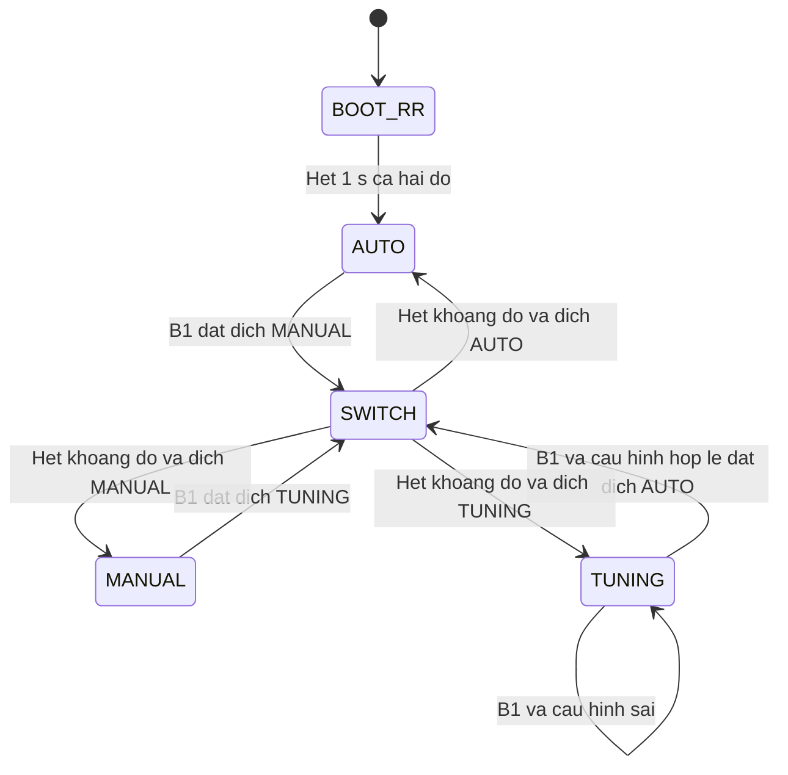
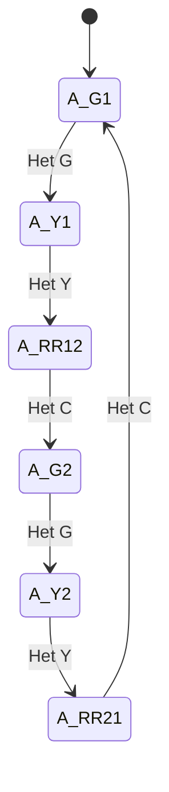
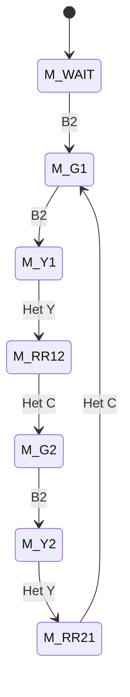
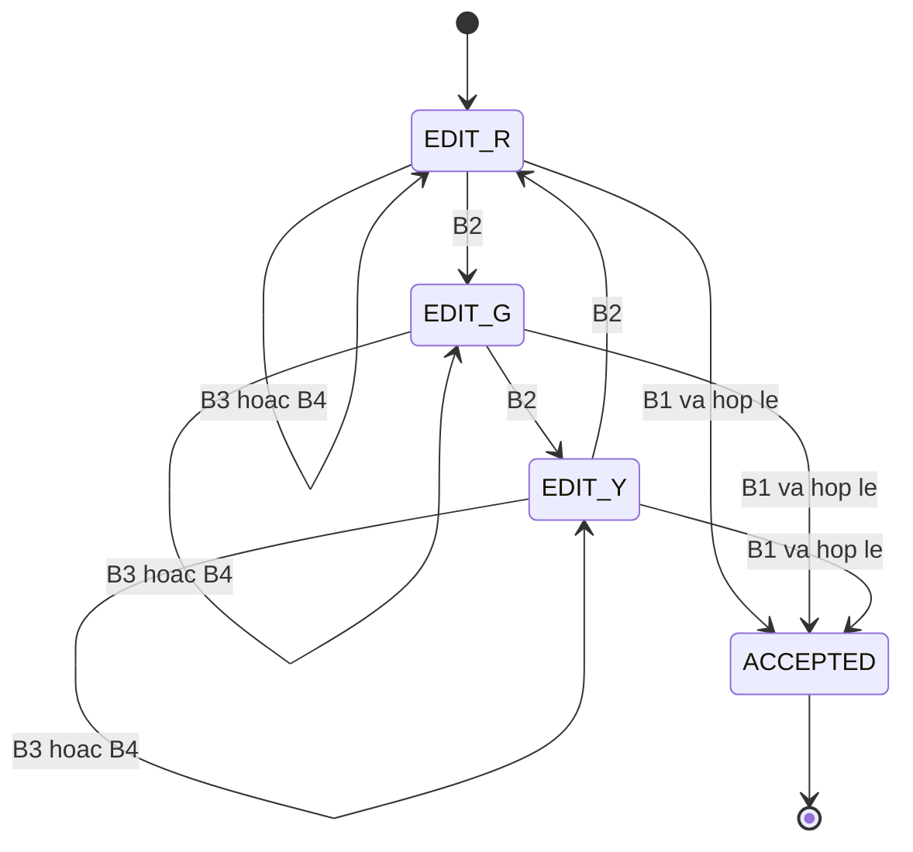

# CO3009-06 Thiết kế FSM và quy tắc an toàn

**Bản thiết kế để nhóm rà soát.** Đề yêu cầu Automatic, Manual và chỉnh thời gian, cùng phân tích an toàn cho mọi lần chuyển chế độ. Quy ước nút, thời lượng và khoảng cả hai đèn đỏ dưới đây là lựa chọn thiết kế đề xuất. Thiết kế dùng [hợp đồng API CO3009-02](https://github.com/benhiepcse/CO3009-Traffic-Light/blob/389a5ef905e79953719ea4065947de556686b79c/docs/api-contract.md). Đối chiếu các kết quả kỳ vọng với ca kiểm thử trong `CO3009-05`.

## 1. Đầu vào và đầu ra của FSM

Ký hiệu `G/Y/R` là xanh/vàng/đỏ. Cặp `G/R` nghĩa là **đường 1 xanh, đường 2 đỏ**. Đọc nút đã chống dội, dùng **sự kiện nhấn mới**. Giữ nút không tự lặp và phải nhả nút mới sinh lần nhấn kế tiếp.

| Nút đề xuất | Automatic | Manual | Timing adjustment |
|---|---|---|---|
| B1 MODE, `BUTTON_D7` | Yêu cầu Manual | Yêu cầu Tuning | Kiểm tra và xác nhận để về Auto |
| B2 NEXT, `BUTTON_D8` | Không thao tác | Từ chờ cho đường 1 đi, sau đó yêu cầu đổi đường | Chọn trường tiếp theo `R → G → Y → R` |
| B3 INC, `BUTTON_D9` | Không thao tác | Không thao tác | Tăng trường đã chọn 1 giây |
| B4 DEC, `BUTTON_D10` | Không thao tác | Không thao tác | Giảm trường đã chọn 1 giây |
| `BUTTON_USER`, PC13 | Chưa gán | Chưa gán | Chưa gán |

Mỗi lượt `fsm_run()` lấy các sự kiện đang chờ bằng `button_take_event()` và chỉ xét `BUTTON_EVENT_PRESS`. Nếu có nhiều nút, chọn tối đa một nút có thao tác ở pha hiện tại theo thứ tự B1 → B2 → B3 → B4. B1 được xử lý trước timeout của mode cũ. Trong khởi động và chuyển chế độ, bỏ sự kiện bằng `button_clear_events()`. Hàm này giữ trạng thái chống dội và giữ nút. Khi kết thúc khoảng đỏ, xóa hàng đợi lần nữa trước khi vào mode mới. Lúc khởi động, nếu `button_poll()` phát một PRESS cho nút đã giữ từ trước reset, sự kiện đó phải được nhận và bỏ trong `BOOT_RR`. Xác nhận khi tích hợp rằng chu kỳ lấy mẫu và cửa sổ chống dội đáp ứng quy tắc này.

## 2. Thời lượng và cách tính pha

Thiết kế dùng cùng bộ thời lượng cho hai đường. `G`, `Y`, `R` lần lượt là số giây xanh, vàng, đỏ của **một** đường trong chu kỳ Automatic ổn định. Mỗi vòng có hai khoảng cả hai đèn đỏ bằng nhau, ký hiệu `C`.

Khi đường 1 đỏ, hệ thống đi qua `R/R → R/G → R/Y → R/R`. Do đó **`R = G + Y + 2 × C`**. Để chỉnh được cả ba thông số mà vẫn có khoảng an toàn, tính `C` từ bộ giá trị đã chọn.

| Tham số | Mặc định | Biên đề xuất |
|---|---:|---|
| Xanh `G` | 5 s | 2–30 s |
| Vàng `Y` | 2 s | 1–5 s |
| Đỏ `R` | 9 s | 5–60 s và `R ≥ G + Y + 2 s` |
| Cả hai đỏ trong chu kỳ `C` | 1 s | `(R − G − Y) / 2`, tối thiểu 1 s |
| Cả hai đỏ lúc khởi động/chuyển mode | 1 s | Khoảng giữ cố định của thiết kế, tách khỏi `C` |

Ở tick 10 ms, đổi `G/Y/R` từ giây sang tick trước khi chia 2 để giữ phần nửa giây. Với đầu vào nguyên giây, `C_ticks = (R_s − G_s − Y_s) × 50`. Kiểm tra bộ giá trị hợp lệ **trước khi** tính hiệu với kiểu không dấu. Bộ mặc định cho `C=100 tick` và chu kỳ `2 × (G+Y+C) = 16 s`. Ví dụ tăng `R` lên 11 s, giữ `G=5` và `Y=2`, thì `C=2 s` và chu kỳ là 18 s.

## 3. FSM cấp hệ thống

Trạng thái `SWITCH` có hai bước. Nếu cặp đèn đang có xanh hoặc vàng, cho đường đó giữ **vàng trong `Y_active` đầy đủ** (kể cả đã vàng trước đó), đường đối diện giữ đỏ. Sau đó chuyển `R/R` và giữ ít nhất 1 s. Nếu đã `R/R`, đi thẳng vào bước giữ `R/R` 1 s. Không xử lý timer của pha cũ sau khi nhận yêu cầu chuyển. Hết khoảng đỏ, khởi tạo đúng chế độ đích một lần.

Ví dụ với bộ mặc định, Nhân có thể thử B1 lúc Auto đang `G/R` ở tick 340. Task FSM hủy timer xanh, xuất `Y/R` và nạp 200 tick. Đến tick 540, xuất `R/R` và nạp 100 tick. Từ tick 640, Manual ở `M_WAIT` với `R/R` và đợi một lần nhấn B2 mới. Các tick này là kỳ vọng khi task được dispatch đúng hạn.

| Chuyển | Đèn và điều kiện vào đích | Timer, task và biến đếm | LCD |
|---|---|---|---|
| Reset → Auto | Khởi tạo đầu ra `R/R`, giữ 1 s. Vào Auto từ pha `A_G1` (`G/R`). | Nạp cấu hình mặc định. Bỏ sự kiện nút cũ, khởi tạo timer khởi động rồi nạp mới timer xanh. | Khởi động, sau đó Auto và nhiệt độ/độ ẩm khi có dữ liệu. |
| Auto → Manual | Từ xanh/vàng đi qua vàng và `R/R` theo quy tắc `SWITCH`. Vào `M_WAIT` với `R/R`. | Hủy timer pha Auto và cờ timeout đang chờ. Xóa bộ đếm pha Auto. Nạp timer chuyển, dừng timer khi vào `M_WAIT`. | Hiện đang chuyển, sau đó Manual và cặp màu. |
| Manual → Tuning | Dùng cùng quy tắc chuyển. Tuning bắt đầu với `R/R`. | Hủy timer pha Manual và yêu cầu đổi đường cũ. Tạo bản nháp từ cấu hình đang chạy, chọn trường `R`. | Hiện đang chuyển, sau đó trường và giá trị đang chỉnh. |
| Tuning → Auto | B1 chỉ chuyển khi bản nháp hợp lệ. Giữ `R/R` 1 s rồi vào `A_G1`. Nếu sai thì ở lại Tuning với `R/R`. | Lưu bộ hợp lệ chờ áp dụng. Hết khoảng đỏ mới thay toàn bộ cấu hình đang chạy, tính `C`, nạp timer xanh đầy đủ. | Nếu sai, báo lỗi và cho chỉnh tiếp. Nếu đúng, hiện đang chuyển rồi về Auto. |

**Quyền sở hữu đầu ra.** Đề xuất đăng ký `fsm_run()` bằng `SCH_Add_Task(fsm_run, 1, 1)` cho cả ba mode, chờ một tick trước lần chạy đầu và chạy mỗi tick sau đó. Lịch này giữ nguyên khi chuyển mode. Bộ điều phối gọi `traffic_set_pair()` để đổi đèn. `dht20_poll()` chỉ cập nhật dữ liệu DHT20. Bộ điều phối đọc mẫu lưu và quyết định nội dung LCD theo mode để nhiệt độ/độ ẩm không ghi đè menu Tuning hoặc thông báo chuyển mode.

## 4. FSM Automatic

| Pha | Đường 1 / đường 2 | Nạp timer khi vào | Hết timer |
|---|---|---:|---|
| `A_G1` | `G/R` | `G` | `A_Y1` |
| `A_Y1` | `Y/R` | `Y` | `A_RR12` |
| `A_RR12` | `R/R` | `C` | `A_G2` |
| `A_G2` | `R/G` | `G` | `A_Y2` |
| `A_Y2` | `R/Y` | `Y` | `A_RR21` |
| `A_RR21` | `R/R` | `C` | `A_G1` |

Chỉ áp dụng đèn và nạp timer **khi vào pha**, không nạp lại ở mỗi lượt chạy task. Bắt đầu đo thời gian sau khi driver đã áp dụng cặp màu. Nếu task được chạy muộn, chỉ chuyển một pha và bắt đầu đếm pha mới từ lúc áp dụng đèn, tránh rút ngắn vàng hoặc `R/R` để đuổi theo lịch cũ. B1 được bộ điều phối xử lý từ mọi pha.

## 5. FSM Manual

| Pha | Đường 1 / đường 2 | Sự kiện chuyển | Pha tiếp theo |
|---|---|---|---|
| `M_WAIT` | `R/R` | B2 | `M_G1` |
| `M_G1` | `G/R` | B2 | `M_Y1` |
| `M_Y1` | `Y/R` | Hết `Y` | `M_RR12` |
| `M_RR12` | `R/R` | Hết `C` | `M_G2` |
| `M_G2` | `R/G` | B2 | `M_Y2` |
| `M_Y2` | `R/Y` | Hết `Y` | `M_RR21` |
| `M_RR21` | `R/R` | Hết `C` | `M_G1` |

Manual giữ xanh cho đến khi người dùng yêu cầu đổi đường. B2 là yêu cầu đổi quyền đi, còn vàng và khoảng đỏ chạy tự động để người dùng không thể bỏ qua chúng. B2 trong hai pha này bị bỏ qua. B1 vẫn yêu cầu Tuning từ mọi pha.

## 6. FSM Timing adjustment

| Sự kiện | Xử lý và kết quả |
|---|---|
| Vào Tuning | Giữ `R/R`, sao chép bộ giá trị đang chạy sang bản nháp, chọn `R`, hiển thị trường và số giây. |
| B2 | Chọn trường kế tiếp. Xóa thông báo lỗi cũ để hiện trường mới. |
| B3/B4 | Tăng/giảm trường đang chọn 1 s trong biên riêng của trường. Cho phép quan hệ `R/G/Y` tạm thời chưa hợp lệ trong lúc chỉnh. |
| B1, bộ sai | Giữ trường và bản nháp, giữ `R/R`. Báo lỗi như `R < G+Y+2`. Giữ cấu hình đang chạy. |
| B1, bộ đúng | Chuyển một bản sao đầy đủ cho bộ điều phối. Khi hết pha `R/R` của `SWITCH`, áp dụng cả bộ trước khi vào Auto. |

## 7. Kiểm tra an toàn và chuẩn bị code

Các FSM chỉ yêu cầu năm cặp màu `R/R`, `G/R`, `Y/R`, `R/G`, `R/Y`. Chỉ hai trạng thái xanh là `G/R` và `R/G`. Từ một trạng thái xanh sang trạng thái xanh của đường kia luôn có vàng và `R/R` ở giữa. Khi chuyển mode, bộ điều phối cũng đi qua `R/R` trước khi cho phép chế độ đích xử lý. Vì chỉ bộ điều phối cấp quyền ghi đèn, timer của chế độ cũ và sự kiện nút đến trong khi chuyển không thể phát một lệnh đèn song song.

Ở lớp driver, kiểm tra **đường đối diện đã đỏ ổn định trước khi cấp xanh**. Kiểm tra bảng mã hai chân điều khiển của từng module. Nếu phải đổi hai bit, xác minh việc ghi đồng thời hoặc thứ tự ghi cụ thể để tránh màu thoáng qua. Thử bằng trace GPIO hoặc logic analyzer nếu có. Lập luận trên bảo đảm ở mức trạng thái FSM. Điều kiện ở chân thật cần kiểm chứng trong `TC-HW-02` và `TC-MODE-03`, kể cả lần khởi tạo đầu ra.

| Dữ liệu | Nơi giữ đề xuất | Khi nào đổi |
|---|---|---|
| Mode hiện tại, mode đích | Bộ điều phối, khai báo dùng chung trong `global.h/.c` nếu cần | Nhận yêu cầu và hoàn tất `SWITCH` |
| Cấu hình chạy, cấu hình chờ áp dụng | Bộ điều phối và `global.h/.c` | Reset hoặc hoàn tất xác nhận hợp lệ từ Tuning |
| Bản nháp và trường đang chọn | `fsm_tuning` | Vào Tuning và thao tác nút |
| Pha Auto/Manual | Module FSM tương ứng | Vào chế độ hoặc có sự kiện chuyển pha |
| Timer pha, cờ timeout và cặp màu đã áp dụng | Task FSM qua API timer/đèn | Khi vào pha hoặc bắt đầu/kết thúc chuyển mode |

### Luồng gọi theo CO3009-02

1. Sau khi khởi tạo các module, gọi `fsm_init()` để thiết lập bộ mặc định và pha `BOOT_RR`. `traffic_init()` đã đặt đầu ra đỏ–đỏ. `fsm_init()` bắt đầu khoảng giữ bằng `sw_timer_start(SW_TIMER_TRAFFIC_PHASE, 100)`.
2. Khi vào một pha mới, gọi `traffic_set_pair()` với đúng thứ tự đường 1, đường 2. Ví dụ pha `A_Y1` dùng `traffic_set_pair(TRAFFIC_AMBER, TRAFFIC_RED)`. Chỉ cập nhật pha và nạp thời lượng sau khi đặt cặp màu thành công. Nếu yêu cầu cặp màu bị từ chối, dừng chuyển pha và yêu cầu `TRAFFIC_RED, TRAFFIC_RED` để giữ hệ thống ở cả hai đỏ.
3. Khi rời mode, gọi `sw_timer_cancel(SW_TIMER_TRAFFIC_PHASE)` để dừng timer và xóa cờ hết hạn. Trong một pha có thời lượng, gọi `sw_timer_take_timeout(SW_TIMER_TRAFFIC_PHASE)` sau khi xét B1. Hàm trả `true` đúng lúc lấy cờ và xóa cờ đó. `sw_timer_start()` khi vào pha kế tiếp cũng xóa cờ cũ.
4. `sw_timer_tick()` và `button_poll()` chạy từ scheduler. Khi cùng đến hạn, cần cho `sw_timer_tick()` và `button_poll()` chạy trước `fsm_run()`. Nhờ vậy timer pha vừa nạp không bị trừ ngay trong cùng tick, và FSM đọc được sự kiện nút đã lấy mẫu của tick đó. Xác nhận thứ tự này với CO3009-18 và trace `TC-MODE-03`.
5. Ghi màn hình bằng `lcd_write_line(row, text)` với dòng đầu là 0 và giới hạn theo LCD thật. Auto/Manual lấy mẫu bằng `dht20_get_latest()`, chỉ hiển thị số đo khi trạng thái là `DHT20_OK`. Khi ở Tuning hoặc `SWITCH`, giữ màn hình của trạng thái tương ứng.

Khi triển khai `12–15`, dùng mock ghi sự kiện đầu vào, cặp màu, thời điểm nạp/hủy timer và nội dung LCD. Smoke test hiện có của CO3009-02 minh họa API. Các ca cần nhiều sự kiện cùng lúc hoặc cần trace thời lượng phải có mock bổ sung. Chạy các ca `TC-AUTO`, `TC-MAN`, `TC-TUNE`, `TC-MODE` bằng mock trước, rồi dùng cùng kỳ vọng để nghiệm thu trên board.
