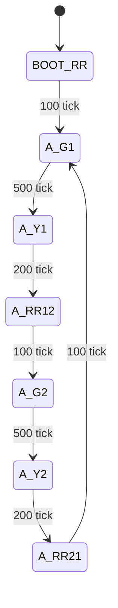

# CO3009-12 Chế độ Automatic

Phần hiện thực dùng hợp đồng API CO3009-02 và [bảng pha Automatic của CO3009-06](https://github.com/benhiepcse/CO3009-Traffic-Light/blob/c10f438237b08589ebdffb994f5c276fa2deba7c/docs/sprint-01/co3009-06-fsm-design.md#4-fsm-automatic). Mỗi tick là 10 ms. Bộ mặc định cho mỗi đường là xanh 5 s, vàng 2 s, đỏ 9 s. Mỗi khoảng cả hai đỏ trong chu kỳ là `(9 − 5 − 2) / 2 = 1 s`. Cả vòng dài 16 s.



| Pha | Đường 1 | Đường 2 | Thời lượng | Pha tiếp theo |
|---|---|---|---:|---|
| `BOOT_RR` | Đỏ | Đỏ | 100 tick | `A_G1` |
| `A_G1` | Xanh | Đỏ | 500 tick | `A_Y1` |
| `A_Y1` | Vàng | Đỏ | 200 tick | `A_RR12` |
| `A_RR12` | Đỏ | Đỏ | 100 tick | `A_G2` |
| `A_G2` | Đỏ | Xanh | 500 tick | `A_Y2` |
| `A_Y2` | Đỏ | Vàng | 200 tick | `A_RR21` |
| `A_RR21` | Đỏ | Đỏ | 100 tick | `A_G1` |

Sau khi khởi tạo các module, `fsm_init()` khôi phục cấu hình mặc định, xóa sự kiện nút và bắt đầu pha cả hai đỏ lúc khởi động. Scheduler gọi `fsm_run()` định kỳ. Khi cùng đến hạn, `sw_timer_tick()` chạy trước `fsm_run()` để pha vừa bắt đầu chỉ bị trừ từ tick kế tiếp. FSM đọc timeout bằng `sw_timer_take_timeout()`, đặt cặp đèn qua `fsm_set_phase()` rồi nạp timer cho pha mới. Nếu dispatch trễ, mỗi lần chỉ chuyển một pha để giữ đủ khoảng vàng và cả hai đỏ. Sau khi tích hợp mã 14–15, Auto đọc cấu hình chạy dùng chung và bộ điều phối xử lý nút chuyển mode theo [tài liệu Sprint 3](../sprint-03/co3009-13-15-fsm.md).

## Kiểm thử trên máy tính

Chạy từ thư mục gốc của repo với GCC và PowerShell.

```powershell
.\tests\host\test.ps1
```

| Ca | Bằng chứng từ test host |
|---|---|
| `TC-AUTO-01` | Kiểm tra từng tick qua ba vòng, mỗi vòng 1.600 tick. Mỗi lần hết hạn có đúng một lệnh đổi pha. Mock đếm cả yêu cầu hai đường cùng xanh mà driver từ chối. |
| `TC-AUTO-02` | Gọi lại `fsm_init()` khi đèn đang xanh hoặc vàng và timeout cũ còn chờ. Cả hai đỏ 100 tick, bỏ sự kiện nút cũ rồi trở lại xanh đường 1 với đủ thời lượng. |
| Dispatch trễ | Giữ pha khi chưa dispatch. Sau khi dispatch, vàng vẫn đủ 200 tick và cả hai đỏ đủ 100 tick. |

Các ca này gọi FSM thật với timer, đèn và nút giả. Phép đo tick, thứ tự dispatch thật và trạng thái GPIO thuộc ca chạy trên board sau khi tích hợp.
